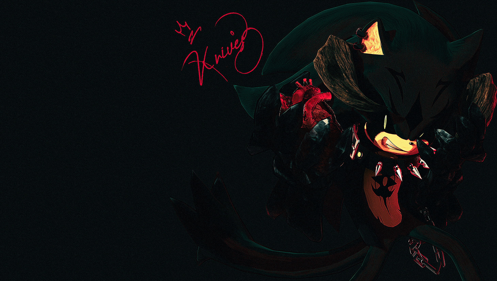

<p align="center">
  
</p>

# Hi, I'm 奈依茲・悪魔的 [JP: Naizu Akumateki - EN: KnivesDevilish] but you can call me Knives! 👋

**🍊 3DCG Artist (Blender) • 🎙️ Dōjin Seiyū & Content Creator • ☢️ Creator of *"Naizu The Hedgehog"* Series • 🏁 Sonic Riders: Source • 🚧 Madness Framework (Godot) • 🧩 OSS Enthusiast • 🍋 CS:CZ**

> 🐧 *Living inside Linux (`Linuxの中`)*

---

### 📡 Transmission & Links

[](https://x.com/Naizu_Akumateki)
[](https://www.youtube.com/@Naizu_Seiy%C5%AB)
[](https://discord.com/invite/nKCxxCzm3X)

---

```yaml
# 🐧 ~/knives_devilish/profile.yml
location: "Linuxの中 (Venezuela 🇻🇪)"
focus:
  - "General Programming & Software Architecture"
  - "Stylized 3D Character Pipelines & Hybrid Art Workflows (Blender + Krita)"
  - "Engine Scripting, Open-Source Tooling & Static Recompilation"
```

### 🗂️ Active Threads & Lore

- 🏁 **Active Build:** Porting and statically recompiling ***Sonic Riders: Source*** alongside architecting ***Madness Framework*** in Godot.
- ☢️ **Original IP:** Directing, modeling, and voicing the ***"Naizu The Hedgehog"*** universe.
- 🎙️ **Voice & Broadcast:** Independent *Dōjin Seiyū* (voice actor), video creator, and live streamer.
- 💻 **R&D Lab:** Experimenting with low-level systems, CMake cross-compilation (PC & Android), and open-source engine internals.
- 🍋 **Off-Duty:** *Counter-Strike: Condition Zero* (`CS:CZ`) veteran and daily Linux nerd.

### ⚙️ Toolchain & Arsenal

<p align="left">
  
  
  
  
  
  
  
  
</p>

---

### 📊 Telemetry & Stats

<p align="center">
  <a href="https://github.com/anuraghazra/github-readme-stats">
    
  </a>
  <a href="https://github.com/aungpyaephyo143/github-readme-streak-stats">
    
  </a>
  <a href="https://github.com/anuraghazra/github-readme-stats">
    
  </a>
</p>
